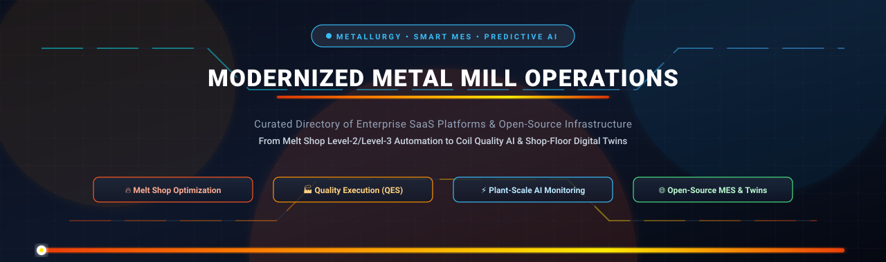

<div align="center">



# 🏭 Awesome Modernized Metal Mill Operations Platforms

### *The Definitive Directory of SaaS Platforms & Open-Source Infrastructure for Metallurgy, Quality Execution (QES), MES, and Plant-Scale AI Monitoring*

<p align="center">
  <a href="https://github.com/ishandutta2007/Awesome-Awesome-Awesome"></a>
  <a href="https://discord.gg/jc4xtF58Ve"></a>
  <a href="https://github.com/ishandutta2007/Awesome-Modernized-Metal-Mill-Operations-Platforms/stargazers"></a>
  <a href="https://github.com/ishandutta2007/Awesome-Modernized-Metal-Mill-Operations-Platforms/network/members"></a>
  <a href="LICENSE"></a>
  <a href="https://github.com/ishandutta2007/Awesome-Modernized-Metal-Mill-Operations-Platforms/pulls"></a>
  <a href="https://github.com/ishandutta2007"></a>
</p>

---

</div>

## 📌 Executive Summary & Architectural Scope

Modern metal production—spanning basic oxygen furnaces (BOF), electric arc furnaces (EAF), secondary metallurgy (ladle furnaces, vacuum degassing), continuous casting, hot strip rolling, and cold coil finishing—relies on high-frequency operational software pipelines.

This repository tracks the leading **enterprise SaaS ecosystems** and **open-source engineering frameworks** purpose-built for:
- 🔬 **Metallurgical Process Optimization**: Dynamic thermal equilibrium models, scrap charge mix optimization, and alloy addition calculations.
- 📋 **Quality Execution Systems (QES)**: Coil genealogy, surface defect mapping, automated grading, and ISO 9001/IATF 16949 compliance.
- ⚡ **Plant-Scale AI & Predictive Maintenance**: Real-time anomaly detection on mill stands, motor drives, couplers, and bearings using high-speed time-series telemetry.
- 🌐 **Modern Manufacturing Execution Systems (MES)**: Shop-floor dispatching, Level 2/Level 3 industrial automation bridges, and ERP synchronization.

---

## 📑 Table of Contents

- [📊 Sector Overview & Market Dynamics](#-sector-overview--market-dynamics)
- [🏢 Enterprise SaaS & Commercial Platforms](#-enterprise-saas--commercial-platforms)
- [🌐 Open-Source GitHub Projects](#-open-source-github-projects)
- [🏗️ Architectural Blueprint: Building a Modern Mill Stack](#️-architectural-blueprint-building-a-modern-mill-stack)
- [🤝 How to Contribute](#-how-to-contribute)
- [⭐ Star History](#-star-history)
- [💖 Support & Sponsoring](#-support--sponsoring)
- [⚖️ Disclaimer](#️-disclaimer)

---

## 📊 Sector Overview & Market Dynamics

The global market for **metals and process industry Manufacturing Execution Systems (MES) and digital smart manufacturing software** is estimated at **$16.5B to $18.6B in 2025–2026**, on track to reach over **$39B to $56B by 2034** with a compound annual growth rate (CAGR) of **10.1% to 14.9%**, while dedicated **AI-in-steel operations** accounts for approximately **$9.84B**.

The sector exhibits **moderate concentration among Tier-1 legacy engineering conglomerates** (Techint/Tenova, Mitsubishi Heavy Industries/Primetals, Danieli, SMS group, ANDRITZ) who command deep Level 2/Level 3 automation moats. However, it is experiencing rapid decentralization from **pure-play cloud AI observability vendors** and **open-source modular architectures** driven by plant engineers seeking data sovereignty, real-time edge processing, and avoidance of recurring per-seat proprietary licensing fees.

---

## 🏢 Enterprise SaaS & Commercial Platforms

*Commercial platforms sorted in descending order of parent company scale (annual revenue / valuation).*

| 🏢 Platform & Vendor | 📈 Company Scale (Revenue / Valuation) | 💰 Starting Tier Pricing | 🎁 Free Tier & Trial Limits | ⚙️ Primary Capabilities & Metallurgical Focus |
| :--- | :--- | :--- | :--- | :--- |
| **[Tenova](https://www.tenova.com/)**<br>*(Techint Group)* | **$38.4B Global Revenue**<br>(Parent: Techint Group; Tenova standalone backlog: $2.5B+) | **$60,000 / year**<br>(~$5,000/mo) base subscription per electric arc furnace (EAF) or reheating furnace module | **14-day proof-of-concept trial** with 1 furnace dynamic thermal model simulation using customer historical heat log files | **Cyber-EAF & Virtuo Suite**: Dynamic thermal modeling, chemical energy balance, off-gas continuous monitoring, electrode regulation, and greenhouse gas carbon reduction. |
| **[Primetals Technologies](https://www.primetals.com/)**<br>*(Mitsubishi Heavy Industries)* | **$34.5B Revenue (¥5.2T)**<br>(Parent: MHI; Metals Machinery segment: ~$5.8B) | **$75,000 / year**<br>(~$6,250/mo) starting subscription for Through-Process Optimization (TPO) rule module | **30-day offline metallurgical rule validation trial** limited to 100 historical heat logs and quality grading rules | **Through-Process Optimization (TPO)**: Mill-wide quality grading, Level 2/3 continuous caster digital twin, automated surface defect classification, and hot strip mill automation. |
| **[SmartSteel](https://www.smartsteel.com/)**<br>*(SSAB AB)* | **$9.8B Revenue (SEK 103.4B)**<br>(Parent Market Cap: ~€9.0B / ~$9.7B) | **$1,200 / month**<br>($14,400/yr) for Mill Integration API Tier | **30-day pilot account** limited to 500 digital product passport scans and material test certificate verifications | **Digital Product Passports (DPP)**: Coil genealogy, automated EN 10204 inspection certificates, mechanical property traceability, and scrap recycled-content provenance. |
| **[ANDRITZ Metals](https://www.andritz.com/)**<br>*(ANDRITZ AG)* | **€8.31B (~$9.0B) Revenue**<br>(Market Cap: ~€7.8B on Vienna Stock Exchange) | **$55,000 / year**<br>(~$4,583/mo) for Metris digital platform base module per strip line | **30-day engineering demo sandbox** limited to 2 pre-configured plant simulation models and 25 process variables | **Metris Digital Platform**: Autonomous plant control, pickle line acid concentration optimization, continuous galvanizing quality control, and predictive roll wear analysis. |
| **[Danieli Automation](https://www.danieli.com/)**<br>*(Danieli Group)* | **€4.20B (~$4.5B) Revenue**<br>(Market Cap: €4.81B on Borsa Italiana) | **$70,000 / year**<br>(~$5,833/mo) starting tier for DIGI&MET / Q-PULSE plant monitoring module | **30-day simulated melt-to-coil tracking trial** configured for 1 virtual rolling mill line with synthetic telemetry | **DIGI&MET & Q-PULSE**: End-to-end plant telemetry, liquid steel to finished coil quality prediction, robotic mill operations, and slab surface defect detection. |
| **[Quinlogic](https://www.quinlogic.com/)**<br>*(SMS group GmbH)* | **€4.03B (~$4.38B) Revenue**<br>(Family-owned enterprise; Net liquidity: €929M) | **€4,000 / month**<br>(€48,000/yr / ~$52,000/yr) base tier for LogicDesigner per production unit | **14-day guided proof-of-concept sandbox** evaluating up to 50 surface defect scan maps and coil grading criteria | **Quality Execution System (QES)**: DataCorrelator big data analytics, LogicDesigner custom rule grading, surface defect mapping, and digital twin representation for cold & hot rolled coils. |
| **[Fives Group](https://www.fivesgroup.com/)**<br>*(Fives Group)* | **€2.14B (~$2.32B) Revenue**<br>(Privately held engineering group; backed by CDPQ) | **$50,000 / year**<br>(~$4,166/mo) base tier for Eyeris surface defect mapping & thermal tracking suite | **21-day pilot evaluation** processing up to 25 coil inspection image batches and surface classification models | **Eyeris Surface Inspection & Process Tracking**: Optical surface inspection, reheating furnace combustion automation, strip flatness control, and coil strip thermal profile management. |
| **[Falkonry](https://www.falkonry.com/)**<br>*(IFS AB / EQT)* | **$10.0B Valuation**<br>(Parent IFS ARR: $1.1B+; Falkonry raised $13.3M prior to acquisition) | **$2,500 / month**<br>($30,000/yr) for Falkonry Clue plant monitoring tier | **7-day risk-free offline trial** using up to 50 telemetry signals (0.1–100 Hz Parquet files) plus 14-day extended analysis review | **Time-Series AI Anomaly Detection**: Automated precursor detection for equipment failures 3–10 weeks in advance; direct iba high-speed telemetry connector (180k rows/2 mins); roll mill bearing monitoring. |
| **[TMEIC](https://www.tmeic.com/)**<br>*(Toshiba & Mitsubishi Electric JV)* | **$721M - $1.4B Annual Revenue**<br>(¥213B non-consolidated JV scale) | **$40,000 / year**<br>(~$3,333/mo) for PlantDirector Level 2 drive analytics module | **30-day virtual commissioning testbench** restricted to 1 virtual drive train simulator and 10 simulated motor signals | **PlantDirector & n-Drives Automation**: Variable frequency drive telemetry, rolling mill automatic gauge control (AGC), strip tension optimization, and motor vibration signature diagnosis. |
| **[PSI Metals](https://www.psi.de/en/solutions/products/psimetals)**<br>*(PSI Software SE)* | **€269.9M (~$290M) Revenue**<br>(Market Cap: ~€750M / $815M on Frankfurt Stock Exchange) | **$50,000 / year**<br>(~$4,166/mo) base module subscription for PSImetals Order Dressing or Quality Manager per site | **30-day proof-of-concept sandbox** with pre-loaded EAF/BOF charge mix and slab qualification datasets (max 5 users) | **PSImetals Production Suite**: Integrated Supply Chain Management, APS, and MES; qoncept qontrol maps for real-time scrap quality assessment; automated Tata Steel slab qualification; SAP certified. |

---

## 🌐 Open-Source GitHub Projects

*Open-source platforms, protocols, databases, and digital twins sorted in descending order of GitHub stargazers.*

| 📦 Repository & Project | ⭐ GitHub_Stars_Badge | 🛠️ Technology Stack | 💡 Metal Mill Operations Application |
| :--- | :--- | :--- | :--- |
| **[Grafana](https://github.com/grafana/grafana)** | [](https://github.com/grafana/grafana/stargazers) | Go, TypeScript, React | Real-time mill-wide telemetry dashboards displaying roll stand motor temperatures, hydraulic pressures, furnace thermocouple heat maps, and coil surface speeds. |
| **[Odoo Manufacturing](https://github.com/odoo/odoo)** | [](https://github.com/odoo/odoo/stargazers) | Python, JavaScript, PostgreSQL | Modular ERP & MRP suite with work-center routing, maintenance schedules, multi-level bills of materials (BOM), and shop-floor quality inspection checkpoints. |
| **[ERPNext](https://github.com/frappe/erpnext)** | [](https://github.com/frappe/erpnext/stargazers) | Python, Frappe Framework, MariaDB | Complete open-source ERP with manufacturing work orders, scrap material accounting, stock batch tracking, heat serial numbers, and equipment downtime logs. |
| **[InfluxDB](https://github.com/influxdata/influxdb)** | [](https://github.com/influxdata/influxdb/stargazers) | Rust, Apache Arrow / DataFusion | High-throughput time-series database handling millions of high-frequency (100 Hz+) sensor metrics from mill PLCs, optical pyrometers, and vibration accelerometers. |
| **[Node-RED](https://github.com/node-red/node-red)** | [](https://github.com/node-red/node-red/stargazers) | Node.js, JavaScript | Visual flow programming for OT/IT convergence at the mill edge. Ingests Modbus TCP, OPC UA, and Siemens S7 signals, routing events to MQTT and time-series databases. |
| **[TimescaleDB](https://github.com/timescale/timescaledb)** | [](https://github.com/timescale/timescaledb/stargazers) | C, PL/pgSQL, PostgreSQL | SQL-native relational time-series engine using hypertables to store mill sensor histories, coil metallurgy logs, and perform fast analytical roll-ups. |
| **[ThingsBoard](https://github.com/thingsboard/thingsboard)** | [](https://github.com/thingsboard/thingsboard/stargazers) | Java, TypeScript, Netty | Industrial IoT server providing plant-scale sensor telemetry collection, rule-engine alerts, motor anomaly notifications, and SCADA-like operational dashboards. |
| **[open62541](https://github.com/open62541/open62541)** | [](https://github.com/open62541/open62541/stargazers) | C99, CMake | Certified open-source implementation of OPC UA (IEC 62541), providing the low-latency communication backbone for Level 1/Level 2 industrial automation. |
| **[Apache PLC4X](https://github.com/apache/plc4x)** | [](https://github.com/apache/plc4x/stargazers) | Java, Go, C | Universal industrial protocol adapter allowing modern applications to communicate directly with Siemens S7, Modbus, Allen-Bradley Ethernet/IP, and Beckhoff ADS PLCs. |
| **[Eclipse Milo](https://github.com/eclipse-milo/milo)** | [](https://github.com/eclipse-milo/milo/stargazers) | Java | Complete open-source implementation of the OPC UA specifications for enterprise Java applications, commonly used in MES gateways and mill data extractors. |
| **[frePPLe](https://github.com/frePPLe/frepple)** | [](https://github.com/frePPLe/frepple/stargazers) | C++, Python, Django | Advanced Planning and Scheduling (APS) and supply chain planning engine tailored for complex rolling mill sequence constraints, heat campaigns, and coil setups. |
| **[WebErpMesv2](https://github.com/SMEWebify/WebErpMesv2)** | [](https://github.com/SMEWebify/WebErpMesv2/stargazers) | PHP 8.3, Laravel 12, MariaDB | Open-source ERP/MES under MIT license for small-to-mid sheet metal fabrication, machining, and stamping plants; includes quote-to-delivery workflows and ISO 9001 QA. |
| **[OpenMES](https://github.com/Mes-Open/OpenMes)** | [](https://github.com/Mes-Open/OpenMes/stargazers) | Laravel 12, Tailwind CSS 4, Alpine.js | Modern, extensible Manufacturing Execution System with hook-based CRUD events (`ResourceChanged`), live shift counters, barcode station scanning, and custom reporting. |
| **[qcadoo MES](https://github.com/qcadoo/qcadoo)** | [](https://github.com/qcadoo/qcadoo/stargazers) | Java, Spring, PostgreSQL | Open-source web-based MES for manufacturing SMEs, tracking work orders, machine downtime, material genealogy, scrap declarations, and operator assignments. |
| **[Eclipse 4diac FORTE](https://github.com/eclipse-4diac/4diac-forte)** | [](https://github.com/eclipse-4diac/4diac-forte/stargazers) | C++ | Lightweight runtime environment for distributed industrial process control based on the IEC 61499 standard for event-driven, hardware-independent automation. |
| **[DynReAct](https://github.com/DynReAct/OSS_Platform)** | [](https://github.com/DynReAct/OSS_Platform/stargazers) | Python, Multi-Agent Systems | EU RFCS-funded (Grant No 101112421) hierarchical production planning platform for steel mills across LTP (monthly), MTP (lot scheduling), and STP (multi-agent deviations). |
| **[Steel Industry Digital Twin](https://github.com/marcosoares-92/steelindustrysimulator)** | [](https://github.com/marcosoares-92/steelindustrysimulator/stargazers) | Python, Google Colab, Scikit-Learn | Deep-learning digital twin reproducing energy consumption behavior of steel mini-mills (DAEWOO Steel dataset), optimizing power factor, reactive power, and peak kWh. |
| **[JaamSim](https://jaamsim.com/)** | *(Independent OSS)* | Java, 3D Graphics Engine | Open-source discrete-event simulation software applied in steel plants to evaluate furnace charge bottlenecks, crane conflicts, and rolling mill throughput scenarios. |

---

## 🏗️ Architectural Blueprint: Building a Modern Mill Stack

Plant engineers, OT/IT architects, and systems developers can integrate these open-source and modular SaaS components into an enterprise-grade, data-sovereign metal mill operations stack:

```
+-----------------------------------------------------------------------------------+
|                        LEVEL 4: BUSINESS PLANNING & ERP                           |
|           ERPNext / Odoo Manufacturing / SAP ERP / PSImetals Order Dressing       |
+-----------------------------------------------------------------------------------+
                                        |  (Work Orders, Sales Orders, BOM)
                                        v
+-----------------------------------------------------------------------------------+
|               LEVEL 3: PRODUCTION PLANNING, MES & QUALITY EXECUTION               |
|   DynReAct (Hierarchical APS) + OpenMES / WebErpMesv2 + Quinlogic QES Rules       |
|    - Scrap charge calculation    - Coil grading rules    - Heat schedule dispatch |
+-----------------------------------------------------------------------------------+
                                        |  (Machine Instructions, Shift Targets)
                                        v
+-----------------------------------------------------------------------------------+
|              LEVEL 2: PROCESS SUPERVISION, DIGITAL TWINS & AI                     |
|   Falkonry Clue (Anomaly AI) + Steel Plant Digital Twin + InfluxDB / TimescaleDB  |
|    - Anomaly detection (motors)  - Energy optimization   - Pyrometer heat trends  |
+-----------------------------------------------------------------------------------+
                                        |  (OPC UA / Modbus / Siemens S7)
                                        v
+-----------------------------------------------------------------------------------+
|               LEVEL 1 / LEVEL 0: PLANT SENSORS, PLCs & EDGE BUS                   |
|   Apache PLC4X + open62541 + Eclipse Milo + Node-RED Edge Gateway                |
|    - Ladle thermocouples         - Mill roll load cells  - Optical line cameras   |
+-----------------------------------------------------------------------------------+
```

---

## 🤝 How to Contribute

We welcome contributions from metallurgists, automation engineers, and industrial software developers!

1. 🍴 **Fork the repository** to your personal GitHub account.
2. 🌿 **Create a topic branch**: `git checkout -b feature/add-new-platform`.
3. 📝 **Add or update an entry**: Ensure entries adhere to the table structure, including verified pricing tiers, company size/valuation, and accurate GitHub Stars_Badges.
4. ✅ **Ensure accuracy**: Descriptions must be factual, non-promotional, and cite authoritative documentation or academic grant papers.
5. 🚀 **Submit a Pull Request** with a concise summary of the addition or revision.

---

## ⭐ Star History

[](https://star-history.dera.page/#ishandutta2007/Awesome-Modernized-Metal-Mill-Operations-Platforms&type=date&legend=top-left)

---

## 💖 Support & Sponsoring

Thank you for exploring the **Awesome Modernized Metal Mill Operations Platforms** directory! If this resource has helped you discover industrial manufacturing platforms, open-source MES solutions, or metallurgical process optimization tools, please consider supporting the project:

- ⭐ **Star this repository** on GitHub to help other engineers find it.
- 🍴 **Fork the project** and contribute additional tools, platforms, or research citations.
- 📢 **Share with your colleagues**, plant automation engineers, and metallurgy specialists.
- ☕ **Buy me a coffee / Sponsor**: If you appreciate this curated knowledge base, support ongoing research and updates via the [GitHub Sponsor Dashboard](https://github.com/sponsors/ishandutta2007).

---

## ⚖️ Disclaimer

- This is a **community-curated research directory** intended for educational, architectural, and operational reference only. Mention of commercial platforms or open-source repositories does not constitute an official endorsement.
- Metal mill operations involve high temperatures, high-voltage equipment, and molten materials governed by strict industrial safety standards and quality certifications (ISO 9001, IATF 16949, OSHA).
- **Metallurgical parameters, chemical compositions, and furnace heat settings must be validated by qualified metallurgists and safety engineers before live plant implementation.**
